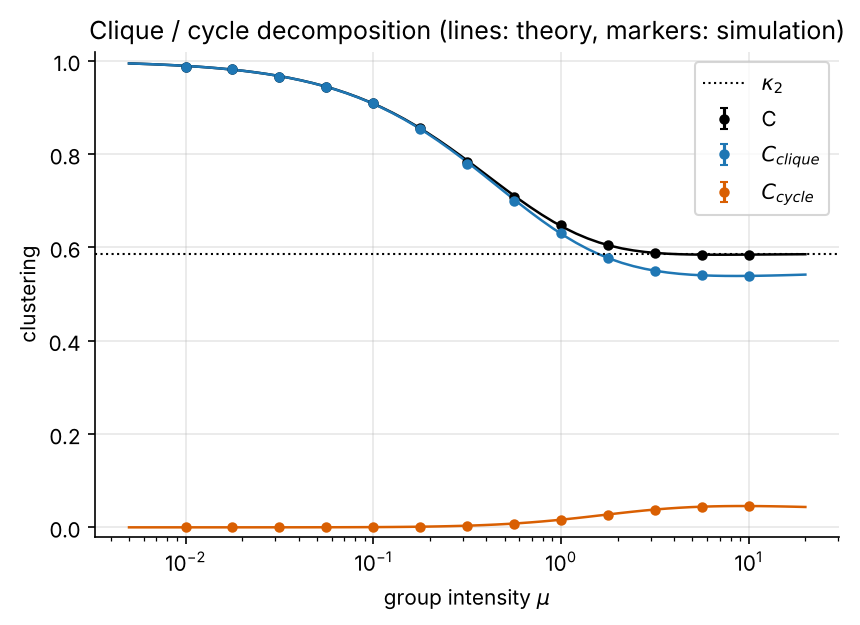
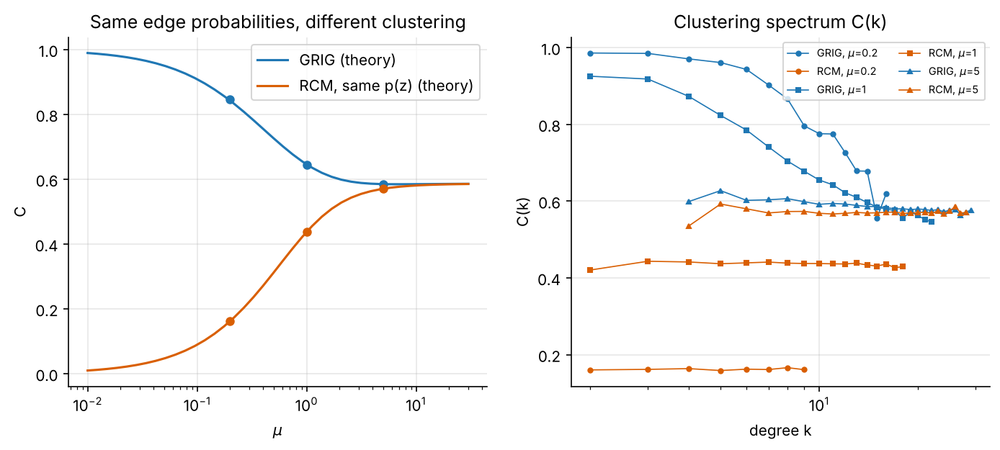
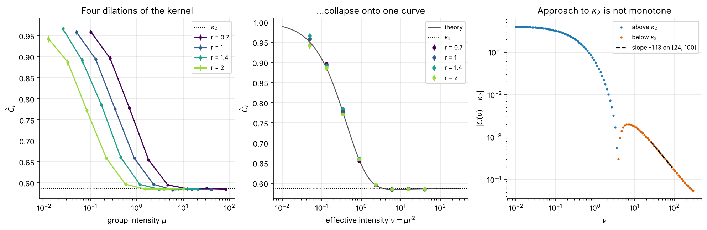

# Clustering in the Geometric Random Intersection Graph

[](https://github.com/alberto-denicolo/grig-clustering/actions/workflows/ci.yml)


Code and experiments for my master's thesis *The Geometric Random Intersection Graph Model: Clustering and Local
Structure* (University of Padova, 2026, supervisor Prof. Alessandra Bianchi).

The full text is available here: [thesis (PDF)](tesi_magistrale_DeNicolo.pdf).

The GRIG (Deijfen and Michielan, 2024) places vertices and groups as two independent Poisson processes in ℝᵈ; a vertex
joins a group with probability g(distance), and two vertices are adjacent when they share a group. This package

- **simulates** the model on the flat torus, keeping the latent bipartite layer, so that every triangle can be
  classified as a *clique* triangle (one group covers all three vertices) or a *cycle* triangle (three different
  groups);
- **computes the theory** deterministically: connection probability 1 − e^(−µ g∗g), expected degree, and the
  configuration integrals whose ratio is the clustering coefficient C = C_clique + C_cycle;
- **reproduces every figure and table of chapter 4** of the thesis, and adds three new experiments.

<p align="center">
  
  
</p>

## Main results

**Simulation and theory agree everywhere.** For the Boolean kernel (R = 1, λ = 1.5, µ = 1) the configuration
integrals give C = 0.645858, and the pooled estimate stays within about one standard error of it on every torus from
L = 12 (735 graphs, 0.6458 ± 0.0008) to L = 42 (60 graphs, 0.6449 ± 0.0009). The expected degree matches its formula
at the seven parameter points of Table 4.2 (all within 1.9 standard errors), and the clique/cycle split measured on the
bipartite layer follows the theory over three orders of magnitude of µ.

**The three asymptotic regimes of chapter 3 are visible numerically.**

| Regime | Prediction | Measured here |
|---|---|---|
| Sparse attributes, µ → 0 | C → 1, C_cycle = Θ(µ²) | fitted exponent 1.974 |
| Attribute-rich, g ↦ µ^(−1/2) g | C → C_RCM = 0.43723 | 0.4428 ± 0.0010 at µ = 1000, theory 0.43723 in the limit |
| Continuum, ν = µr² → ∞ | C → κ₂ = 1 − 3√3/(4π) = 0.58650 | curves for four dilations collapse on C(ν); C(ν) dips to 0.58449 at ν = 6.90 before reaching κ₂ at rate ν^(−1.13) |

**New in this repository** (not in the thesis):

- **Same edges, different clustering.** A random connection model with *the same* connection probability
  p(z) = 1 − e^(−µ g∗g) as the GRIG has the same mean degree but much lower clustering: 0.16 against 0.85 at µ = 0.2.
  The difference is the positive correlation between edges that share a group; it also shows in the degree variance
  (11.1 against 2.6) and in the clustering spectrum C(k), which decreases with k in the GRIG and is flat in the RCM.
- **Dimension 3.** The share of clustering carried by cycle triangles in the continuum limit is 0 in d = 1 (Helly's
  theorem), 4.1% in d = 2 and **11.5% in d = 3** (σ₃ = 0.4146 ± 0.0001 against κ₃ = 15/32).
- **The decomposition converges much more slowly than C.** At ν = 100, C is within 2·10⁻⁴ of κ₂, but C_cycle is still
  0.036 against its limit κ₂ − σ₂ = 0.024 (0.029 at ν = 10³, 0.026 at ν = 10⁴).
- **Giant component.** At equal expected degree, fewer and larger groups delay percolation. The largest component
  holds more than half of the vertices from expected degree 4.3 when µ = 5 and from 5.6 when µ = 1, while with µ = 0.3
  it stays below 4% of the vertices up to expected degree 4.8: the members of a group form a clique, so for small µ
  most of the degree is spent inside isolated clusters.
- With the exponential kernel at unit mass, C(µ) is not monotone: it reaches 0.377 at µ ≈ 5.8 and then rises again.

<p align="center">
  
</p>

## Quick start

```bash
git clone https://github.com/alberto-denicolo/grig-clustering.git
cd grig-clustering
python -m venv .venv && source .venv/bin/activate      # Windows: .venv\Scripts\activate
pip install -e ".[dev]"
```

Simulate a few graphs and compare with the theory:

```bash
grig simulate --lam 1.5 --mu 1 --L 20 --replicates 50
```

```
50 graphs on the torus of side 20.0: boolean kernel, lambda=1.5, mu=1.0
mean degree        8.3114   (theory 8.3126)
clustering C       0.6444   (theory 0.6459)
  clique part      0.6269   (theory 0.6295)
  cycle part       0.0175   (theory 0.0164)
```

From Python:

```python
import numpy as np
from grig import boolean, sample, counts, configuration_integrals

g = sample(boolean(R=1.0), lam=1.5, mu=1.0, L=20.0, rng=np.random.default_rng(0))
print(counts(g))  # vertices, edges, wedges, triangles, clique/cycle triangles
th = configuration_integrals(boolean(1.0), mu=1.0)
print(th.C, th.C_clique, th.C_cycle)  # 0.64586 0.62945 0.01641
```

## Reproducing the thesis

```bash
make quick     # every experiment on small sizes, a few seconds
make all       # full configuration of the thesis: about 3 minutes on 2 cores, then all figures
```

All parameters are in [`configs/thesis.yaml`](configs/thesis.yaml); results go to `results/` as CSV and figures to
`figures/`. Replicate *k* of parameter point *i* in experiment *e* has its own seed (seed, e, i, k), so any number can
be recomputed in isolation, and replicates run in parallel (`n_jobs`).

| Experiment | Thesis | What it shows | Figure |
|---|---|---|---|
| `kernels` | Table 4.1 | ∫ g∗g = ‖g‖², truncation radii | — |
| `connection_probability` | Fig. 4.5 | adjacency by distance vs 1 − e^(−µ g∗g) | [figure](figures/connection_probability.png) |
| `expected_degree` | Table 4.2 | mean degree vs λ ∫ p | — |
| `convergence` | Fig. 4.6 | no finite-size trend; fluctuations ∝ L^(−d/2) | [figure](figures/convergence.png) |
| `vertex_intensity` | Fig. 4.7 | densities ∝ λ³, C independent of λ | [figure](figures/vertex_intensity.png) |
| `decomposition` | Fig. 4.8 | C = C_clique + C_cycle against µ | [figure](figures/decomposition.png) |
| `sparse_regime` | Table 4.3, Fig. 4.9 | µ → 0 | [figure](figures/sparse_regime.png) |
| `attribute_rich` | Fig. 4.10 | g ↦ µ^(−1/2) g, limit = RCM | [figure](figures/attribute_rich.png) |
| `continuum_limit` | Fig. 4.11 | dilation collapse, approach to κ₂ | [figure](figures/continuum_limit.png) |
| `dimensions` | §4.3.4 | κ_d and σ_d by Monte Carlo (10⁷ configurations) | — |
| `kernel_comparison` | Fig. 4.12 | Boolean vs exponential at ‖g‖ = 1 | [figure](figures/kernel_comparison.png) |
| `grig_vs_rcm` | new | GRIG vs RCM with the same p(z) | [figure](figures/grig_vs_rcm.png) |
| `higher_dimensions` | new | simulated C(µ) in d = 1, 2, 3 | [figure](figures/higher_dimensions.png) |
| `percolation` | new | size of the largest component | [figure](figures/percolation.png) |

The two-step construction itself is drawn in [`figures/construction.png`](figures/construction.png).

## How it works

**Simulation** (`simulate.py`). On the torus [0, L)ᵈ a Poisson process is sampled exactly (Poisson count, uniform
positions). A periodic k-d tree returns the vertex–group pairs within the kernel's reach, each kept with probability
g(distance); this is the incidence matrix B. The graph is A = 1{BBᵀ > 0}. Triangles come from the sparse product
(A²∘A), and the clique triangles are the distinct vertex triples sharing a column of B, so C_cycle follows by
difference and Ĉ = Ĉ_clique + Ĉ_cycle holds exactly in every realization.

**Estimators** (`estimators.py`). C is the pooled ratio 3 Σ triangles / Σ wedges over replicates (the empirical form of
3ρ△/ρ∧, with smaller ratio bias than the mean of per-graph ratios); standard errors are delete-one jackknife across
replicates.

**Theory** (`theory.py`). By rotation invariance the configuration integrals reduce to three variables (r₁, r₃, θ) and
are computed with Gauss–Legendre rules, splitting θ where |v₁ − v₃| = 2R. For the Boolean kernel the triple overlap
|B_R(0) ∩ B_R(v₁) ∩ B_R(v₃)| is exact (Green's theorem on the boundary arcs); for other kernels it uses importance
sampling with one scrambled Sobol sample. The self-convolution g∗g of unbounded kernels is integrated over the
half-plane closer to the origin, which keeps the cusp of g(x − z) out of the domain.

## Notes on the numbers in the thesis

- **Power-law kernel.** Table 4.1 reports a 2.4% error on ∫ g∗g = ‖g‖² for the power law and attributes it to the
  quadrature; with the half-plane integration above the error is 1·10⁻⁵, the same order as the other kernels.
- **Table 4.3.** The integrals I∧/µ and I△,clique/µ computed here are about 0.12% below those printed in the table
  (31.211 against 31.250 at µ = 0.01). The value here is converged to seven digits in the number of nodes, and an
  independent Monte Carlo evaluation gives 31.20 ± 0.02. The clique fractions, which are the quantities discussed in
  the text, agree to four digits.
- **Crossing of κ₂.** Root-finding on the theoretical curve puts the crossing at ν = 3.73 (3.80 in the text, read off
  a grid); the minimum, 0.58449 at ν = 6.90, and the rate exponent, −1.13 on [24, 100], agree with the thesis.
- **Large ν.** Above ν ≈ 20 the default 48 nodes per variable are not enough; the `continuum_limit` experiment uses
  128 (`theory_nodes` in the config), which reproduces the gaps 4.8·10⁻⁴ and 1.7·10⁻⁴ at ν = 40 and 100.

## Repository layout

```
src/grig/
    kernels.py       connection functions (Boolean, exponential, Gaussian, power law), norms, truncation radius
    geometry.py      torus distance, lens areas, exact area of the intersection of three disks
    simulate.py      two-step construction on the torus, triangle and clique-triangle counts, RCM sampler
    estimators.py    pooled ratio and jackknife
    theory.py        g*g, connection probability, expected degree, configuration integrals, kappa_d, sigma_d
    experiments.py   the 14 experiments
    plotting.py      figures
    cli.py           `grig run | plot | simulate`
configs/             thesis.yaml (full) and quick.yaml (CI)
results/             CSV output of the full run
figures/             PNG figures (PDF versions are created by `make all`)
tests/               42 tests, including the reference values of the thesis
```

## Tests

`make test` runs 42 tests. Among them: C = 0.645860 and the three configuration integrals of §4.3.1; the seven expected
degrees of Table 4.2; the RCM limit 0.43723; the small-µ constant ‖g‖³ = π³; the closed-form g∗g of the Gaussian;
the triple-disk area against Monte Carlo, including the equilateral configuration of side 1.9R where all pairs of
disks meet but the three do not; triangle counts against NetworkX; clique triangles against brute-force enumeration;
that the random connection model sampler has the GRIG's mean degree; and every experiment on the quick configuration.

## References

- M. Deijfen, R. Michielan. Geometric random intersection graphs with general connection probabilities. *Journal of
  Applied Probability* 61(4), 2024. doi:10.1017/jpr.2024.18
- M. Bloznelis. Degree and clustering coefficient in sparse random intersection graphs. *Annals of Applied
  Probability* 23(3), 2013. doi:10.1214/12-aap874
- G. Last, M. Penrose. *Lectures on the Poisson Process*. Cambridge University Press, 2017.

## Citation and license

Please cite with [`CITATION.cff`](CITATION.cff) (GitHub's "Cite this repository" button). MIT license.

Alberto De Nicolò · [LinkedIn](https://linkedin.com/in/alberto-denicolo)
